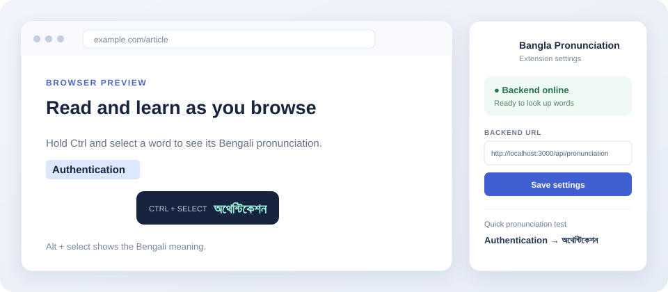

<div align="center">

# English to Bangla Pronunciation

Chrome ও Firefox-এ নির্বাচিত ইংরেজি শব্দের বাংলা উচ্চারণ বা অর্থ দেখুন।

[](https://addons.mozilla.org/en-US/firefox/addon/bangla-phonetic-pronunciation/)
[](https://github.com/SecurityTalent/English-to-Bangla-Pronunciation-Firefox/raw/refs/heads/main/dist/bangla-phonetic-pronunciation-chrome-v1.0.8.zip)
[](https://github.com/SecurityTalent/English-to-Bangla-Pronunciation-Firefox/raw/refs/heads/main/dist/bangla-phonetic-pronunciation-firefox-v1.0.6.zip)

<br>

</div>

## কীভাবে ব্যবহার করবেন

> [!IMPORTANT]
> **উচ্চারণ:** ইংরেজি লেখা নির্বাচন করার সময় **Ctrl** চেপে ধরুন।
>
> **বাংলা অর্থ:** লেখা নির্বাচন করার সময় **Alt** চেপে ধরুন।
>
> একবারে সর্বোচ্চ ৫০০ অক্ষর নির্বাচন করা যায়। ফলাফল নির্বাচিত লেখার পাশে দেখা যায়।

প্রকাশিত বিল্ডগুলো `securitytalent-pronunciation-api.onrender.com` HTTPS API ব্যবহার করে। ব্যবহার করতে Node.js বা নিজের Gemini API key লাগবে না; API পরিচালনাকারী key-টি রাখেন।

> [!WARNING]
> এই সংস্করণে API Render-এর **Free** hosting এবং Gemini API-এর ফ্রি/কোটা-নির্ভর সুবিধার ওপর চলে। ১৫ মিনিট অনুরোধ না এলে Render Free সার্ভারটি sleep-এ যায়; পরের অনুরোধে জাগতে প্রায় এক মিনিট লাগতে পারে। ফ্রি host বা API-তে quota/ব্যবহারসীমা, rate limit, সাময়িক outage, restart, নীতিমালা বা মূল্য পরিবর্তনের কারণে lookup ধীর বা বন্ধ হতে পারে। Render Free production অ্যাপের জন্য নয়; নিরবচ্ছিন্ন সেবার নিশ্চয়তা নেই। Extension-এর নির্বাচিত লেখা cache miss হলে Gemini-তে পাঠানো হয়। Gemini-র free tier-এ জমা দেওয়া content Google-এর পণ্য উন্নত করতে ব্যবহৃত হতে পারে। API key সার্ভারে private রাখা হয়, তবে উন্মুক্ত shared API অপব্যবহৃত হলে পরিচালনাকারীর Gemini quota শেষ বা service সীমিত হতে পারে। সংবেদনশীল লেখা পাঠাবেন না; [Render Free plan](https://render.com/docs/free), [Gemini API pricing ও data use](https://ai.google.dev/gemini-api/docs/pricing) দেখুন।

পাবলিক API-তে প্রতি IP থেকে ডিফল্টে মিনিটে **৬০টি** lookup করা যায়। সীমা পেরোলে `429` আসে; `Retry-After` সময় অপেক্ষা করে আবার চেষ্টা করুন। সীমাটি সার্ভারের মেমরিতে রাখা হয়, তাই সার্ভার restart হলে reset হয়।

## ইনস্টল

1. উপরের বোতাম থেকে আপনার ব্রাউজারের ZIP নামিয়ে Extract করুন।

**Chrome**

1. `chrome://extensions` খুলুন এবং **Developer mode** চালু করুন।
2. **Load unpacked** চাপুন এবং Extract করা Chrome ফোল্ডারটি নির্বাচন করুন, যেখানে `manifest.json` আছে।
3. পুরোনো কপি থাকলে নতুন ফোল্ডার লোড করার পর reload করুন বা পুরোনোটি সরান।

**Firefox**

Firefox 140 বা নতুন সংস্করণ প্রয়োজন। নির্বাচিত ওয়েবপেজের লেখা lookup-এর জন্য backend-এ পাঠানো হয় বলে Firefox-এর ডেটা সম্মতির বার্তা দেখায়।

1. `about:debugging#/runtime/this-firefox` খুলুন।
2. **Load Temporary Add-on...** চাপুন এবং Extract করা Firefox ফোল্ডারের `manifest.json` নির্বাচন করুন।
3. Firefox restart করলে অস্থায়ী add-on সরিয়ে দেয়; restart-এর পর আবার লোড করুন।

স্থায়ী ব্যবহারের জন্য [Mozilla Add-ons-এ Firefox সংস্করণটি](https://addons.mozilla.org/en-US/firefox/addon/bangla-phonetic-pronunciation/) দেখুন। ডাউনলোডযোগ্য Firefox ZIP/XPI পরীক্ষার জন্য; স্থায়ী Firefox release-এ Mozilla-র signing লাগে।

### API সচল আছে কি না দেখুন

[API health check](https://securitytalent-pronunciation-api.onrender.com/api/health) খুলুন। `"status":"ok"` থাকলে backend উত্তর দিচ্ছে। Extension toolbar-এর সেটিংসেও সংযোগের অবস্থা দেখা যায়। সার্ভার সচল থাকলেও Gemini quota বা provider সমস্যায় lookup ব্যর্থ হতে পারে।

## API

ডিফল্ট pronunciation URL:

```text
https://securitytalent-pronunciation-api.onrender.com/api/pronunciation
```

Extension সেটিংসে সম্পূর্ণ pronunciation URL বদলালে meaning ও health URL সেখান থেকে নির্ধারিত হয়।

| Method | Endpoint | কাজ |
| --- | --- | --- |
| `GET` | `/api/health` | API health, Gemini key সেট করা আছে কি না, model ও cache size জানায়; key নিজে প্রকাশ করে না। |
| `POST` | `/api/pronunciation` | বাংলা হরফে উচ্চারণ দেয়। |
| `POST` | `/api/meaning` | সংক্ষিপ্ত বাংলা অর্থ দেয়। |

Lookup-এর JSON: `{"text":"authentication"}`। লেখা ফাঁকা হতে পারবে না এবং ৫০০ অক্ষরের বেশি হলে গ্রহণ করা হয় না। `/api/pronunciation` ব্রাউজারে সরাসরি খুললে GET হওয়ায় 404 আসা স্বাভাবিক; ব্রাউজারে পরীক্ষা করতে `/api/health` খুলুন।

## নিজের backend চালানো (ঐচ্ছিক)

Development বা ব্যক্তিগত API-র জন্য [Node.js 18+](https://nodejs.org/) ইনস্টল করুন এবং [Google AI Studio](https://aistudio.google.com/apikey) থেকে Gemini key নিন। প্রকল্পের মূল ফোল্ডারে চালান:

```powershell
npm.cmd --prefix backend install
if (-not (Test-Path backend/.env)) { Copy-Item backend/.env.example backend/.env }
notepad backend/.env
```

`backend/.env`-এ `GEMINI_API_KEY=`-এর পরে নিজের key লিখে সংরক্ষণ করুন। তারপর:

```powershell
npm.cmd start
```

টার্মিনাল চালু রাখুন। Extension সেটিংসে Backend URL দিন `http://localhost:3000/api/pronunciation`। Key শুধু backend-এর `.env`-এ রাখুন; extension source বা GitHub-এ কখনো যোগ করবেন না। macOS/Linux-এ `npm.cmd`-এর বদলে `npm` ব্যবহার করুন।

## নিজের API deploy করা

1. `backend/`-কে HTTPS-সমর্থিত host-এ deploy করুন।
2. `GEMINI_API_KEY`-কে host-এর private environment variable হিসেবে সেট করুন; repository-তে commit করবেন না।
3. `/api/health` পরীক্ষা করুন এবং Gemini usage/quota নজরে রাখুন।
4. বড় বা public ব্যবহারের জন্য authentication বা shared/edge rate limiter যোগ করুন। বর্তমান in-memory per-IP সীমা restart-এ মুছে যায় এবং একা যথেষ্ট abuse protection নয়।
5. Extension সেটিংসে নতুন HTTPS `/api/pronunciation` URL দিন অথবা দুই browser-এর background script-এ `DEFAULT_SETTINGS.backendUrl` বদলে build করুন।
6. বাস্তব hosting, log ও retention অনুযায়ী [গোপনীয়তা নীতি](PRIVACY.md) হালনাগাদ ও প্রকাশ করুন।

ফ্রি hosting-কে গুরুত্বপূর্ণ বা production সেবার নিশ্চয়তা হিসেবে ধরবেন না। Host-এর sleep, restart, cold start, bandwidth/compute quota, outage, নীতিমালা/মূল্য পরিবর্তন এবং account/service suspension-এর ঝুঁকি আছে। Gemini-র ফ্রি quota সীমিত ও পরিবর্তনশীল; shared public API-তে অতিরিক্ত বা অপব্যবহারমূলক অনুরোধ quota দ্রুত শেষ করতে পারে। Gemini free-tier request-এর content Google-এর পণ্য উন্নত করতে ব্যবহৃত হতে পারে—তাই user-এর সংবেদনশীল লেখা পাঠানোর আগে বর্তমান data-use শর্ত দেখুন। নির্ভরযোগ্য সেবার জন্য provider-এর বর্তমান শর্ত যাচাই করে paid/always-on hosting, usage monitoring ও ব্যয়সীমা পরিকল্পনা করুন।

## Source থেকে build

```powershell
npm.cmd run build
```

ফলাফল `dist/`-এ: browser ZIP, unpacked folder এবং unsigned Firefox XPI। Backend পরীক্ষা চালাতে port 3000-এ চলমান service বন্ধ করে `npm.cmd test` ব্যবহার করুন।

## সমস্যা সমাধান

- **API বন্ধ বা ধীর:** [health endpoint](https://securitytalent-pronunciation-api.onrender.com/api/health) দেখুন। Render Free-তে দীর্ঘ বিরতির পর প্রথম lookup ধীর হতে পারে।
- **Gemini key নেই:** প্রকাশিত API-র operator-কে জানাতে হবে। নিজের backend হলে `backend/.env`-এ key দিয়ে restart করুন।
- **ফল আসে না:** Ctrl বা Alt ধরে ইংরেজি লেখা নির্বাচন করুন; ৫০০ অক্ষরের মধ্যে রাখুন। API error/quota হলে পরে আবার চেষ্টা করুন।
- **পুরোনো Chrome code:** নতুন folder থেকে extension reload করে webpage refresh করুন।
- **Chrome local demo:** Extension Details-এ **Allow access to file URLs** চালু করে demo tab reload করুন।

## গোপনীয়তা

Lookup চাইলে নির্বাচিত লেখা (সর্বোচ্চ ৫০০ অক্ষর) নির্ধারিত backend-এ যায়; cache-এ না থাকলে Gemini-তেও পাঠানো হতে পারে। অপরিচিত backend-এ গোপন বা সংবেদনশীল লেখা পাঠাবেন না। বিস্তারিত [গোপনীয়তা নীতি](PRIVACY.md)।

## প্রকল্পের গঠন

- `chrome/` — Chrome extension source
- `firefox/` — Firefox extension source
- `backend/` — Node.js API
- `dist/` — তৈরি করা download ও unpacked package
- `docs/setup.md` — setup, API ও release নির্দেশিকা
- `PRIVACY.md` — গোপনীয়তা নীতি
- `Requerment.md` — পণ্যের চাহিদা ও গ্রহণযোগ্যতার শর্ত
